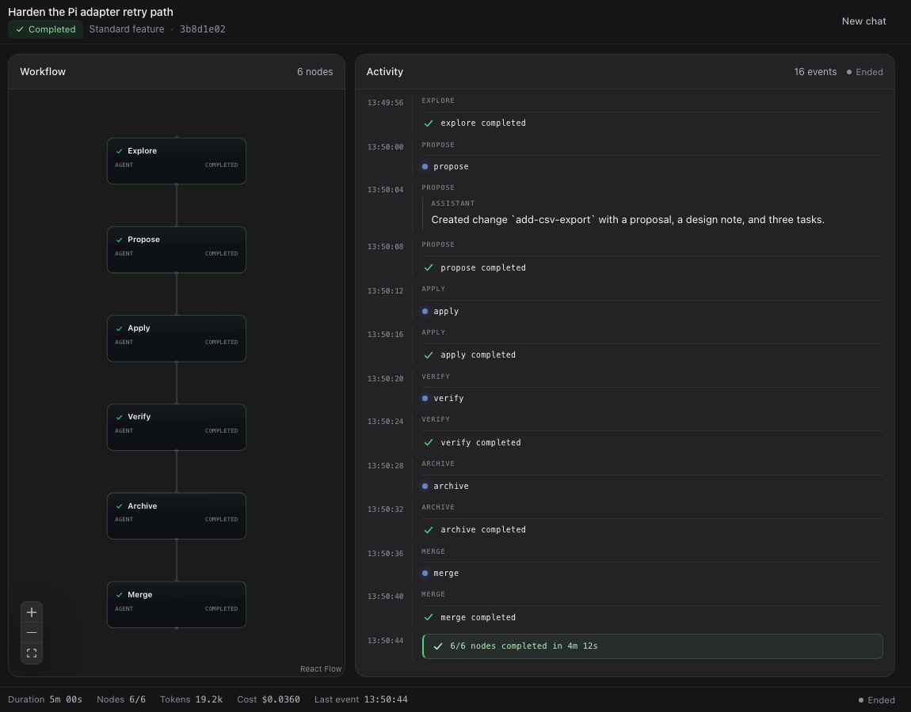

# SpecFlow

**A visual orchestrator for spec-driven agent development.** Draw the steps of a
feature workflow, bind each one to a skill, model, and harness, then let one
binary run the graph in an isolated git worktree — checking every step against
the repository and streaming progress to the UI.



> **Status: orchestrator foundations.** A workflow runs end to end today:
> isolated worktree, postcondition checks, retry and resume, approval gates, and
> a live event stream — with Pi as the first harness. Workflows are canonical
> YAML; the flow editor edits a structured draft and the server writes the file.

<sub>Name note: this project is unrelated to the retired .NET BDD framework of
the same name, and to any other project called SpecFlow.</sub>

## Why

Spec-driven development with coding agents works, but the loop is manual. You
switch between skills, models, and terminal sessions, retype the same
instructions at every step, and have no proof the agent did what it claimed.

SpecFlow makes the loop a program. A workflow is a graph of steps — explore,
propose, apply, review, test, verify, archive, merge. Each node declares what it
needs: a harness, a model, skills, tools, and interaction rules. The orchestrator
owns the parts a prompt cannot: ordering, isolation, verification, and recovery.

## How it works

```text
+-------------------------------------------------------+
|  React workbench: project tree, run view, flow editor |
+---------------------------+---------------------------+
                            | REST + SSE (WebSocket for Q&A)
+---------------------------v---------------------------+
|  Go orchestrator: DAG engine, sessions, OpenSpec      |
|  mapping, embedded UI                                 |
+---------------------------+---------------------------+
                            | harness protocol (JSON events)
+---------------------------v---------------------------+
|  Adapters: Pi first; other harnesses later            |
+-------------------------------------------------------+
```

The frontend is built by Vite into `backend/web/dist` and embedded with
`//go:embed`, so `make build` produces a single `./specflow` binary.

## Features

- **Visual workflows.** A canvas editor for the step graph, with dropdowns for
  harness, model, thinking level, tools, and skills. The server validates the
  structure and writes canonical YAML.
- **Harness-agnostic.** The orchestrator talks to an adapter contract, never to a
  specific runtime. Pi ships first; adding another adapter does not change the
  engine.
- **Isolated runs.** Every run executes in `.specflow/worktrees/<id>` on its own
  `specflow/run-<id>` branch, checkpoints after each node, and merges only
  through an approval-gated command node.
- **Real postconditions.** Node success is checked against the repository —
  `file_exists`, `new_change`, `tasks_complete`, `exit_zero` — not taken from an
  exit code or a model's claim.
- **Live and interactive.** Questions, mid-run injections, cancellation, retry
  (forward or clean), and resume at the failed node, all over REST + SSE.
- **OpenSpec gates.** The canonical workflow validates the run's change and runs
  the test suite before it archives and merges.

## Quickstart

Clone the repository, then:

```bash
make install   # pnpm install --frozen-lockfile + go mod download
make build     # Vite build -> go:embed -> ./specflow
./specflow     # http://localhost:8080
```

Requirements:

- Go 1.27 or newer
- Node.js 22 or newer
- pnpm 10 (`corepack enable` picks up the version pinned in `frontend/package.json`)
- The [OpenSpec](https://github.com/Fission-AI/OpenSpec) CLI, for the canonical
  workflow's verify and archive steps
- Optional: [Pi](https://pi.dev) on `PATH` with credentials, to execute agent
  nodes. Building and testing do not need it.

## Documentation

| Document | What it covers |
| :--- | :--- |
| [Architecture](docs/architecture.md) | Components, run lifecycle, isolation, repository layout |
| [Workflows](docs/workflows.md) | Workflow YAML, node kinds, postconditions, timeouts, retry |
| [API](docs/api.md) | REST endpoints, interactive requests, SSE event stream |
| [Workbench](docs/ui.md) | Project tree, run view, flow editor, routes |
| [Harnesses](docs/harnesses.md) | Adapter contract, error classes, Pi integration, e2e ladder |
| [Development](docs/development.md) | Build targets, tests, build identity |

## Development

```bash
make dev    # API on :8080 + Vite on :5173 (proxies /api)
make test   # go test ./... + frontend typecheck + Vitest suite
```

`make build` always builds the frontend first, because `go:embed` fails without
`backend/web/dist`. See [Development](docs/development.md) for the full target
list and the build-identity details.

## Status

What works today:

- A run loads a pinned workflow, executes nodes in a worktree, checks each
  postcondition, and streams sequenced events that replay from `Last-Event-ID`.
- A failed node can be retried forward or cleanly from its checkpoint; a failed
  run resumes at the failed node.
- A server restart repairs runs it left `running`, `waiting_approval`, or
  `waiting_answer` into ordinary failed runs that can be retried.
- The canonical workflow has been run end to end against real Pi and OpenSpec
  through the opt-in e2e ladder.

Known limits:

- One node runs at a time. Independent branches are representable but not
  concurrent.
- One SpecFlow server per checkout: runs are advanced by the process that
  started them.
- The workbench is local, unauthenticated, and single-user. There is no auth,
  billing, or multi-user support.

Non-goals: a new agent harness, a generic no-code automation tool, or a Docker
requirement for basic usage.

## Contributing

Issues and pull requests are welcome. Read [CONTRIBUTING.md](CONTRIBUTING.md)
first — behavior changes start as an OpenSpec change and land through
`make test` plus `openspec validate`.

## License

[MIT](LICENSE)
