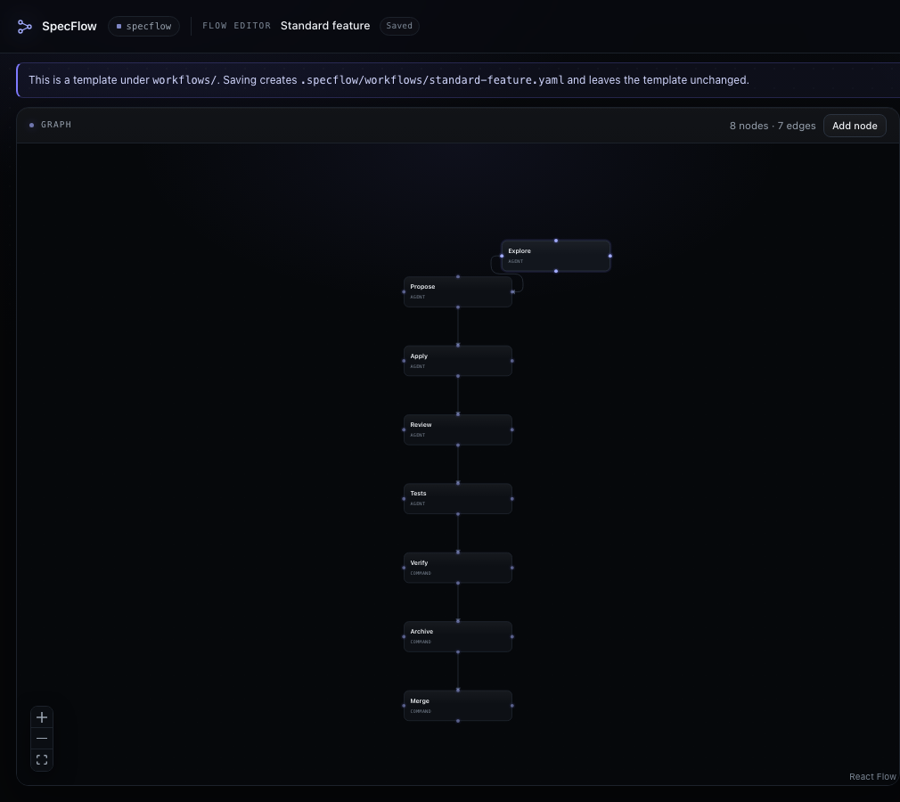

# Workbench

`./specflow` serves the workbench at `http://localhost:8080`. It is a client of
the same API that `curl` uses. The window has two regions: a persistent left
control panel for choosing objects, and a workspace for the selected object.

## Projects and the tree

The workbench holds multiple projects. The registry is an ordered list in this
browser (`localStorage`, key `specflow.projects`) plus the active path
(`specflow.project`); a browser that used an older single-project build upgrades
in place.

The control panel is a tree:

- Each project is a node. Expanding it shows two leaves: **Chats** lists its
  runs, newest first with active runs before terminal ones; **Flows** lists its
  workflow files with node and edge counts and validity. Collapsing the node
  hides both and stops their reads.
- A chat row opens that run in its owning project; a flow row opens that flow's
  editor. Each leaf has its own `+` action: **New chat** activates the project
  and opens the composer for it, **New flow** opens a blank editor scoped to that
  project. The active project is marked on its node, and the open run or flow is
  marked in its leaf.
- Two projects that end in the same folder name show a parent-path suffix so
  they stay distinguishable. The tree is the whole navigation: there are no
  Chat/Flows tabs and no flows index page.
- **Settings** in the panel foot owns the registry: switch the active project,
  add one with an absolute path or **Browse…** for the operating system's folder
  dialog, or remove it from the workbench (files are not deleted). Removing the
  active project activates the next registered one.

The workbench also shows which server it is talking to. **Settings** reports the
running build's revision, build and start times, and whether that build is up to
date with the checkout; a build that is behind the checkout adds a warning above
the view asking for a restart. Both read `GET /api/server` on mount and when the
window regains focus, so rebuilding and restarting the API clears the warning
without a page reload.

The registry, the active project, and the panel's collapsed flag are the only
shell state in `localStorage`; the run view keeps its activity-split width under
`specflow.runSplit`.

## Routes

| Workspace | URL |
| :--- | :--- |
| Chat home (new run) | `/` |
| Chat session | `?run=<id>&project=<path>` |
| Flow editor | `?view=editor&edit=<reference>&project=<path>` (no `edit` starts a new flow) |

A run id and a flow reference are only unique inside one project, so those routes
carry the project they belong to. Opening such a URL adds and activates that
project; the chat home uses the active project. An older link without `project`
resolves through the active project, and a deep link with no known project shows
the project gate without dropping the link. The old `?view=history` and
`?view=flows` URLs both open the chat home. Browser back and forward move between
the tree's objects.

## Chat home

The chat home is the start-run composer for the active project: pick a flow from
its `.specflow/workflows/` or `workflows/` directory, describe the objective, and
start. Structurally invalid flows are listed with their problems and cannot be
selected. A harness that is installed but not ready is shown as a warning without
blocking the form.

Starting renders the graph from the definition pinned to the run and replays the
event stream from the beginning. When the active project has no usable flow, the
selector is disabled with **No flows available** and a centered **New flow**
action sits on the same row. Workspace headers do not repeat tree navigation.

## Run workspace

The run workspace keeps the graph, the event stream, the interaction dock, and
the retry/resume controls.

- Questions appear in the interaction dock; clarifications can be queued while a
  node runs.
- An approval gate shows the action it would start and warns that rejecting ends
  the run cancelled.
- A thin status bar under the workspace reports duration, node progress, tokens,
  cost, the last event, and the stream connection.
- Graph topology comes from the pinned workflow (`GET /api/runs/{id}/graph`),
  never from node order, and positions are computed deterministically from edges,
  so status changes never move the graph.
- The run record from `GET /api/runs/{id}` is the only source of node and run
  state; the SSE stream is narrative. Lifecycle events trigger a coalesced
  refetch, and detail events never construct state.

## Flow editor

Open the editor from a project's **Flows** leaf: choose its `+`, the composer's
**New flow** when the project has no usable flow, or select a flow row to edit
that flow. The workspace header shows the flow name, its file, and its save
state, with **Close** and **Save workflow** actions, and the URL carries the
project. Closing returns to the chat home.

- **New flow** opens `?view=editor&project=<path>` on the Workflow tab with a
  blank draft. Name the flow (for example `Some new flow`); the file name is
  derived from that name (`some-new-flow.yaml`) and the server saves it under
  that project's `.specflow/workflows/`. Once the file exists its reference is
  fixed.
- Selecting an existing flow opens
  `?view=editor&edit=<reference>&project=<path>`. Editing a template under
  `workflows/` and saving creates the project copy; the template itself is
  untouched.
- Add nodes; a new node appears at the visible canvas center in the first free
  slot. Drag from a node's bottom or right handle to another node's top or left
  handle to connect them; the edge attaches to the handles you used.
- Click a node or an edge to select it. Selecting an edge opens its From/To form
  in the Edges tab; changing either endpoint rewires it and **Reverse** swaps its
  direction. **Delete/Backspace** removes the selected edge, or the selected node
  after confirmation, unless focus is in a form control.
- Drag the empty canvas to pan; the canvas does not use marquee or text
  selection, so a drag cannot leave a large selection highlight.
- The node **Skills** field is a multi-select of installed skills, grouped by
  source root, with the selection shown as chips. Select more than one and the
  harness receives every resolved path. A skill installed once under
  `.specflow/skills` is enough, so harness-specific copies are not required. A
  comma-separated input remains as a fallback if the catalog cannot be loaded.
- **Model** and **Thinking** are dropdowns driven by the harness catalog.
  Changing the model drops a level the new model cannot use, and thinking is
  disabled for a model that does not reason. An adapter without a catalog keeps
  text inputs with an explanation.
- **Tools** is a multi-select dropdown when the harness reports tools. Clearing
  every tool stores no allowlist, which means the harness default applies.
- Under **Prompt**, the four values the server can render — `{{objective}}`,
  `{{change}}`, `{{run_id}}`, and `{{workdir}}` — are shown as insert chips.
  Unknown placeholders still fail compilation before a node starts.
- A save must carry the content hash the editor opened with; a stale save is a
  `409` and the editor offers a reload. Positions are session-only and are not
  written to the workflow.

## Responsive behavior

Collapsing the panel hides it and leaves a restore control in every view header;
the choice is remembered. Under 900 px the panel becomes an overlay drawer: the
header toggle opens it, the scrim or Escape closes it, and selecting an object
closes it.

The workbench is unauthenticated and intended for local use.
